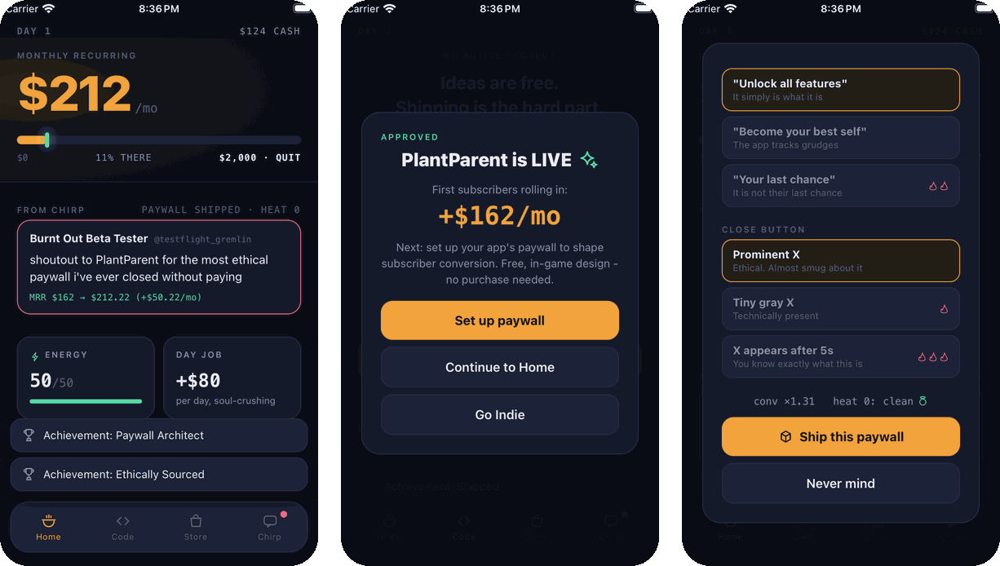

# 🍜 Ramen Profitable

**An idle game about being an indie app developer.** Ship apps, survive App
Review, fight churn, and quit your day job.

**Status:** In TestFlight beta on iOS. Started for RevenueCat's Shipaton 2026
hackathon; I missed the deadline and kept building.



## What's in it

- **The loop.** Tap to write code, submit to App Review, and grow monthly
  recurring revenue to $2,000, the point where you can quit your day job.
- **A paywall designer that punishes dark patterns.** A tiny close button or a
  trial short enough to forget about raises conversion, but it also adds
  "heat" that can backfire on social media and cost you revenue.
- **The paywall in a game about paywalls is real.** "Go Indie" is a real
  one-time purchase through RevenueCat. It doubles offline earnings.
- **A real ad inside a fake phone.** On iPhone and iPad, the Store shows a real
  AdMob banner inside the in-game phone. Buying Go Indie removes it.
- **Offline progress.** Earnings keep accruing while the app is closed, up to
  8 hours.

## How I built it

I build with a crew of AI coding agents through [firstmate]. They write the
code; I own the decisions. I wrote up the rules I use to supervise them in
[Field Notes][field-notes].

- **Agents implement; gates decide what merges.** Changes go through an
  automated AI review ([no-mistakes]) before they become pull requests, and CI
  runs the type check and test suite on every pull request.
- **People keep the human decisions.** firstmate calls the person in charge
  "the captain," and that's me. Anything involving accounts, money, or legal
  declarations, such as App Store privacy answers, ad and purchase dashboard
  settings, and publishing the privacy policy, is marked captain-owned in the
  docs and never done by an agent.
- **Real money fails safe.** An iOS release build refuses to configure without a
  valid production purchase key. If the app can't confirm whether a player has
  paid, it shows no ads instead of guessing.
- **Evidence, not claims.** Interface changes are tested in the iOS Simulator,
  including at the largest accessibility text sizes, with screenshots kept as
  [evidence](docs/PAYWALL_DISCOVERY_VALIDATION.md).

Decisions I'd point to:

- **No paywall on launch.** The purchase screen opens only after a deliberate
  tap.
- **Privacy-light ads.** Non-personalized banners only, no tracking prompt, and
  no ads for anyone who paid.
- **Save only what's safe to restore.** Notifications, pop-ups, and running
  timers are never saved, so reopening the app never drops you into a stale
  screen.

## Architecture

```text
App.tsx                     root: custom dock nav (no react-navigation — deliberate)
src/state/gameStore.ts      zustand store actions and AsyncStorage persist wiring
src/state/experience.ts     offline settlement, Home reactions, paywall receipts, persist allowlist
src/systems/useGameLoop.ts  ticks (500ms/5s/22s) + offline earnings via AppState
src/content/content.ts      every idea, event, rejection, upgrade — add content here
src/content/codePanel.ts    app-specific Code panel source for each idea
src/components/             ui primitives, notification stack, overlay host
src/screens/                Home / Code / Store / Chirp
src/monetization/purchases.ts  RevenueCat wrapper, graceful mock in Expo Go
```

Design decisions worth knowing:

- **State-first:** screens render the zustand store. Home measures visible
  reaction exposure in memory and commits only at focus, occlusion, or expiry
  boundaries. Balancing = numbers in `gameStore.ts` initial state and
  `content.ts`; reaction copy and offline settlement live in `experience.ts`.
- **Persistence** is the allowlist in `selectPersistedState`
  (`src/state/experience.ts`). Transient notifications, overlays, unresolved
  entitlement flags, and in-flight Home priority timers stay out of storage so
  you never rehydrate into a stale modal or a covered countdown.
- **Offline earnings** credit the base interval from `lastSeen` immediately on
  foreground, capped at 8h. A remembered Go Indie owner's unconfirmed remainder
  settles exactly once when entitlement is known; the rate-split and lastSeen
  contracts live in [`docs/ADMOB_SETUP.md`](docs/ADMOB_SETUP.md#entitlements-and-consent).
- **Go Indie** opens the remotely configured RevenueCat Paywall only after a
  deliberate Go Indie tap from the approved-app affordance or Store. There is
  no launch paywall. The lifetime unlock doubles offline earnings only after
  the `go_indie` entitlement is known active; Restore Purchases is available in
  Store.
- **RevenueCat** uses the SDK's `CURRENT` offering without hardcoded product
  identifiers or prices. Dynamic `require` preserves graceful mock fallback
  in Expo Go and development when the native module or Test Store key is
  unavailable. iOS release configuration fails before bundling when its
  production key is missing or malformed, while runtime service failures still
  fail closed for advertising without blocking launch or base offline earnings.

## Balancing cheatsheet

| Knob | Where | Current |
|---|---|---|
| Tap power | `initial.tapPower` | 3 LOC |
| Project size | `newProject` | 250–500 LOC |
| Approval odds | `resolveReview` | 72% (cat QA → 86%) |
| App MRR roll | `resolveReview` | $40–200 base |
| Win condition | `MRR_GOAL` | $2,000 MRR |
| Day length | `slowTick` | ~30s real time |

## Development

Run it, validate changes, and configure purchases and device builds with the
[development guide](docs/DEVELOPMENT.md). Advertising setup is in
[AdMob setup](docs/ADMOB_SETUP.md).

---

Ramen Profitable is a game. Its apps, revenue, reviews, and social posts are
fictional.

[field-notes]: https://fieldnotes.clayj.app
[firstmate]: https://github.com/kunchenguid/firstmate
[no-mistakes]: https://github.com/kunchenguid/no-mistakes
